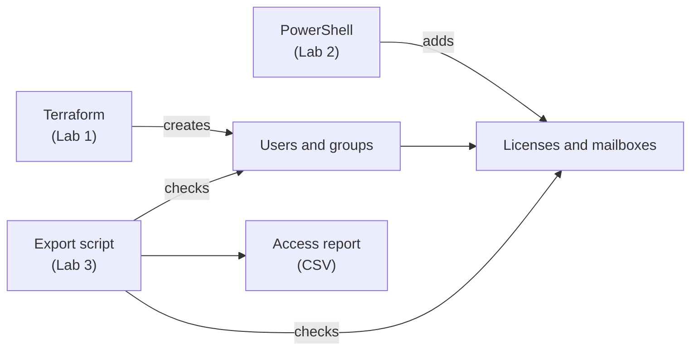

# Microsoft 365 and Entra ID

🎥 **[Watch the video walkthrough](https://www.loom.com/share/8c14c8c267a748f09fca7c83edfe360e)**

## The problem

Every company has people joining and leaving. When that's handled by hand, five things go wrong:

| Business problem | What it costs |
|---|---|
| **New hires wait** for accounts, email, and access | Lost work days |
| **People who leave keep access** to email and files | Security risk, data leaks |
| **Licenses get wasted** on old or shared accounts | Money spent on nobody |
| **Email gets lost** when someone is removed the wrong way | Missing records legal may need |
| **Nobody can prove** who has access to what | Failed audits (like SOC 2, a security audit customers ask for) |

## What this solves

I built a small company setup in Microsoft's cloud to fix each of those:

| Problem | Fix | Lab |
|---|---|---|
| New hires wait | Users and groups built from code, the same way every time | 1 |
| Wasted licenses | Licenses given through groups, and shared mailboxes with no license | 2 |
| People keep access | A step-by-step offboarding checklist | 2 |
| Lost email | Mailbox saved before the license is removed | 2 |
| No proof | A script that lists who has access and flags problems | 3 |

## The labs

Three labs. Each one builds on the one before.

| Lab | What I did | Folder |
|---|---|---|
| 1. Identity | Created users and groups with code | `identity/` |
| 2. Lifecycle | Gave out licenses, made mailboxes, offboarded a user | `lifecycle/` |
| 3. Evidence | Wrote a script that checks who has access | `evidence/` |

---

## The big picture



**Two tools, two jobs:**
- **Terraform** builds the people and groups.
- **PowerShell** handles licenses and email. Terraform can't do those.

---

## Tools

- **Microsoft Entra ID**: the list of people and what they can access
- **Microsoft 365**: email, Teams, and so on
- **Terraform**: builds things from code files
- **PowerShell**: Microsoft's command line (runs on Mac)
- **Microsoft Graph**: how scripts talk to Microsoft 365

---

## Lab 1: Create the people

Terraform created:
- 3 users: Alice, Bob, Carol
- 2 groups: one gives a **license**, one gives **access**
- 1 app identity, so scripts don't use my admin account. Its password expires in 30 days on purpose, so it gets replaced regularly.

**12 things total.** Then I checked them with PowerShell to make sure they really existed.


**One thing I learned:** I used `for_each` instead of `count`. `count` tracks people by number (0, 1, 2). If you remove the middle one, the numbers shift and Terraform deletes people you didn't touch. `for_each` tracks them by name, so only the person you remove is affected.

---

## Lab 2: Licenses, email, and offboarding

**Licenses through a group.** I gave the license to the group, not to each person. Everyone in the group got it automatically.


**The license creates the mailbox.** Before the license, nobody had email. After it, the mailboxes appeared on their own.

**Shared mailbox.** I made a "Finance Inbox" that Alice can open. Shared mailboxes under 50 GB need no license, which saves money.

**Offboarding Carol, in the right order:**

1. Block her sign-in
2. Sign her out everywhere
3. Turn her mailbox into a shared mailbox
4. Remove her from groups (this also removes her license)
5. Check the license is gone
6. Write it in the log

**Why the order matters:** removing the license starts a 30-day countdown to delete her email. So I saved the mailbox first (step 3), then removed the groups (step 4).

> **A mistake I caught:** the original plan removed Carol from groups *before* saving her mailbox. Since the license comes from the group, that would have started the delete countdown too early. I swapped the steps.

The full steps are in [`lifecycle/RUNBOOK.md`](lifecycle/RUNBOOK.md).


---

## Lab 3: Check who has access

`Export-AccessReview.ps1` lists every user with their groups, licenses, admin roles, and last sign-in. It flags:

| Flag | Meaning |
|---|---|
| `DISABLED_BUT_LICENSED` | Blocked user still costing a license |
| `STALE_SIGNIN` | No sign-in for 90 days |
| `NEVER_SIGNED_IN` | Never used the account |
| `PRIVILEGED` | Has admin powers |


**Results:** 5 users (the Finance Inbox counts, because every shared mailbox has a hidden user behind it). Carol shows as disabled with no license, which proves the offboarding worked.

**The bug I tested on purpose.** Microsoft sends users in pages. Without `-All`, the script only reads the first page and still *looks* finished. I broke it on the `bug/pagination` branch: it reported 2 users when there were 5. A report that's missing people is worse than no report, because someone trusts it.

**Control matrix.** [`evidence/CONTROL-MATRIX.md`](evidence/CONTROL-MATRIX.md) lists 10 checks. Two are **not met** yet, and I left them that way because it's true:
- No MFA (multi-factor authentication) rule yet
- The script isn't scheduled to run on its own yet

---

## Problems I hit

| Problem | Fix |
|---|---|
| `pwsh` not found | The preview version installed. Its command is `pwsh-preview` |
| PowerShell commands fail in the normal terminal | Start PowerShell first (`pwsh-preview`) |
| "Please call Connect-MgGraph" | Each new PowerShell window needs a new sign-in |
| `az login` found no subscriptions | Use `az login --allow-no-subscriptions`. This lab needs no Azure subscription |
| Terraform asked for a value | `terraform.tfvars` wasn't saved |
| A `%` at the end of an ID | That's from the terminal, not part of the ID |

---

## Notes

- The trial was **Business Premium**, so the group named `grp-licensing-basic` actually gives Premium. Same steps either way.
- I removed Carol from groups with PowerShell, but Terraform still lists her as a member. Running `terraform apply` again would add her back. In a real setup, that change would be made in the Terraform code.
- Tenant IDs and real domains are replaced with placeholders.

---

## Clean up

```bash
cd identity
terraform destroy
```

Then delete the shared mailbox, remove the group license, and cancel both trials before they start charging.
